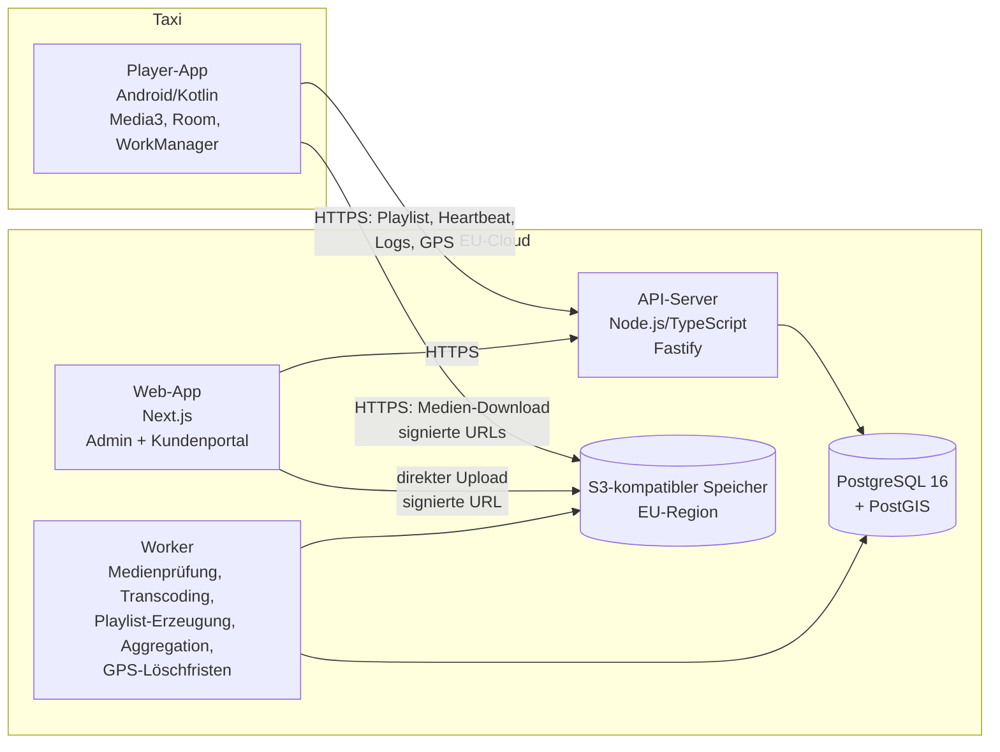

# TaxiAds – Architektur- und Datenmodell-Vorschlag (Entwurf v0.1)

Status: **v0.2 – Entscheidungen eingearbeitet, Phase 1 (Backend) umgesetzt.** Entscheidungen siehe Abschnitt 9.

---

## 1. Überblick



### Komponenten

| Komponente | Technik | Begründung |
|---|---|---|
| Player | Kotlin, Media3/ExoPlayer, Room (SQLite), WorkManager, Android Device Owner + Lock-Task-Modus | Nativ = zuverlässiger Kiosk, Autostart, Helligkeitssteuerung, GPS im Hintergrund |
| API | Node.js 22, TypeScript, **Fastify**, Zod-Validierung, OpenAPI | Fastify ist schneller und schema-orientierter als Express; Zod-Schemas teilen wir mit dem Frontend |
| DB-Zugriff | **postgres.js** (getaggte SQL-Templates) + SQL-Migrationen | Geändert gegenüber v0.1 (Drizzle): PostGIS, `daterange`, Exclusion-Constraints und Partitionierung lassen sich in reinem SQL klarer abbilden; kein zweites Schema im ORM pflegen |
| Hintergrundjobs | eigene, kleine Job-Tabelle in PostgreSQL (`jobs`, `FOR UPDATE SKIP LOCKED`) | Geändert gegenüber v0.1 (pg-boss): ~80 Zeilen, keine weitere Abhängigkeit; Entprellung pro Fahrzeug eingebaut; später austauschbar |
| Datenbank | PostgreSQL 16 + PostGIS, Partitionierung nach Monat für Massendaten | Eine Datenbank für alles, skaliert für tausende Fahrzeuge |
| Medien | S3-kompatibel in der EU (z. B. Hetzner Object Storage, IONOS, Scaleway oder AWS eu-central-1), ffprobe/ffmpeg im Worker | Upload direkt vom Browser über signierte URLs, Server wird nicht belastet |
| Web | Next.js (App Router), React, Leaflet + OpenStreetMap, TanStack Query | Ein Projekt, zwei Bereiche (`/admin`, `/portal`) mit Rollenprüfung |
| Repo | Monorepo (pnpm): `apps/api`, `apps/web`, `apps/player-android`, `packages/shared` | Gemeinsame Typen; Schleifen-/Buchungslogik als reine, gut testbare Bibliothek |
| Betrieb | Docker Compose (Start), später Kubernetes; Hosting in Deutschland/EU | Klein anfangen, ohne Umbau wachsen |

**Begründete Abweichungen vom Vorschlag:** keine grundsätzlichen. Ergänzt habe ich Fastify, postgres.js und eine eigene Job-Tabelle als konkrete Bausteine. Kein Redis/Kafka in v1; wird erst ab mehreren tausend Geräten mit hoher Last relevant und kann dann ergänzt werden.

---

## 2. Kernkonzept: Schleife, Kapazität, Buchung

### 2.1 Begriffe
- **Schleife (Loop):** feste Länge `L` Sekunden pro Fahrzeug (Standard 300).
- **Buchung:** Kampagne mit `X` Sekunden pro Schleife, `N` Fahrzeugen, Zeitraum `[Start, Ende]` (ganze Kalendertage, lokale Zeit).
- **Zuteilung (Allocation):** eine Zeile pro (Kampagne, Fahrzeug, Zeitraum) mit `X` Sekunden. Das ist die eigentliche „verkaufte Zeit“.
- **Kapazitätsregel:** Für jedes Fahrzeug und jeden Tag gilt: `Summe X aller aktiven Zuteilungen ≤ L`.

### 2.2 Verfügbarkeitsprüfung
Ein Fahrzeug ist für eine neue Buchung (X Sekunden, Zeitraum) frei, wenn an **jedem** Tag des Zeitraums `verkauft(Tag) + X ≤ L` ist.
Angezeigt wird dem Kunden: „Im Zeitraum sind **K** Fahrzeuge mit mindestens X freien Sekunden verfügbar“.

Technisch: Zuteilungen haben eine `daterange`-Spalte mit GiST-Index; die Belegung pro Tag wird per SQL berechnet (Tage × überlappende Zuteilungen). Das Ergebnis wird zusätzlich in reiner TypeScript-Logik (`packages/shared/booking`) abgebildet und dort ausführlich getestet.

### 2.3 Automatische Verteilung
1. Kandidaten = aktive Fahrzeuge mit zugeordnetem Gerät, die im gesamten Zeitraum ≥ X Sekunden frei haben.
2. Wenn `Kandidaten < N` → Buchung abgelehnt (oder Teilbuchung, siehe Frage 3).
3. Auswahl nach **Best-Fit**: bevorzugt Fahrzeuge, die schon stärker belegt sind, aber noch passen. So bleiben ganze Fahrzeuge frei für große Buchungen (weniger „Verschnitt“). Gleichstand → Fahrzeug mit der besten Online-Quote der letzten 7 Tage.
4. Die Zuteilung läuft in **einer Transaktion mit Sperre** (`pg_advisory_xact_lock`), damit zwei gleichzeitige Buchungen nicht dieselbe Kapazität verkaufen.

### 2.4 Playlist je Fahrzeug
Der Server erzeugt pro Fahrzeug eine **versionierte Playlist für die nächsten 7 Tage** (Fenster mit `gültig_von/gültig_bis`). Dadurch wechselt der Player um Mitternacht korrekt, **auch ohne Netz**.

Aufbau einer Schleife (Beispiel L = 300):
```
| Kampagne A 15s | Füller 30s | Kampagne B 20s | Füller 25s | Kampagne C 10s | Füller ... | = 300s
```
- Bezahlte Spots werden **gleichmäßig über die Schleife verteilt**, die Lücken mit Füllinhalten aufgefüllt.
- Füllinhalte werden auf die Restzeit zugeschnitten (Bilder: beliebige Dauer; Videos: passende Längen kombinieren, Rest mit Füllbildern).
- **Motivrotation:** Hat eine Kampagne mehrere freigegebene Motive, spielt der Player in Durchlauf `n` das Motiv `n mod Anzahl`. Der Durchlaufzähler wird lokal gespeichert.
- Pausierte Kampagnen: Ihr Platz wird mit Füllinhalt belegt (Kapazität bleibt reserviert, siehe Frage 4).
- Neue Motive erscheinen erst nach Freigabe in der Playlist.

### 2.5 Medienprüfung beim Upload
1. Browser fordert signierte Upload-URL an (Dateityp + Größe werden vorab geprüft).
2. Nach Upload prüft der Worker mit `ffprobe`: Format (MP4/H.264, JPG, PNG, ggf. WebP), Auflösung, **Videolänge ≤ gebuchte Sekunden**, Maximalgröße.
3. Optional Transcoding auf ein einheitliches Format für die Bildschirme (Frage 7).
4. Status → `wartet_auf_freigabe` → Admin gibt frei oder lehnt mit Begründung ab.
5. Ändert der Kunde später X auf einen kleineren Wert, werden zu lange Videos markiert und nicht mehr ausgespielt.

---

## 3. Player-App (Android)

| Funktion | Umsetzung |
|---|---|
| Kiosk + Autostart | App als **Device Owner** (Einrichtung per QR-Code bei Werksreset oder `adb dpm set-device-owner`), Lock-Task-Modus, `BOOT_COMPLETED`, Launcher-Ersatz (HOME-Activity). Statusleiste/Navigation gesperrt |
| Wiedergabe | Media3/ExoPlayer für Videos, ImageView für Bilder; zwei Player-Instanzen im Wechsel für lückenlose Übergänge; stumm (Frage 6) |
| Download | WorkManager, nur in den App-Speicher, Prüfsumme (SHA-256) je Datei, fortsetzbare Downloads; **Wechsel auf neue Playlist erst, wenn alle Dateien vollständig und geprüft sind**; alte Dateien werden erst danach gelöscht |
| Offline-Puffer | Room-Datenbank als Warteschlange für Ausspielungen, GPS und Heartbeats. Jeder Eintrag hat eine vom Gerät erzeugte UUID → Upload ist **idempotent** (Server ignoriert Duplikate), gelöscht wird erst nach Bestätigung durch den Server. Nichts geht verloren, auch nicht bei Absturz |
| Ausspiel-Log | Fahrzeug, Kampagne, Motiv, Start (UTC + Zeitzone), geplante/tatsächliche Dauer, vollständig/abgebrochen (+ Grund), GPS-Position beim Start |
| GPS | Foreground-Service, FusedLocation oder GPS direkt, Intervall vom Server (Standard 30 s) |
| Heartbeat | alle 60 s: Playlist-Version, freier Speicher, aktueller Inhalt, App-Version, Akku/Temperatur falls verfügbar |
| Helligkeit | Zeitplan vom Server (z. B. 06:00–16:00 → 50 %, sonst 5 %), Auswertung in lokaler Zeitzone `Europe/Vienna` (Sommer-/Winterzeit automatisch über `java.time`); gesetzt über `Settings.System.SCREEN_BRIGHTNESS` (als Device Owner erlaubt) + Fenster-Helligkeit |
| Uhrzeit | Netzwerkzeit + Abgleich mit Serverzeit im Heartbeat; Abweichung wird gemeldet |
| Updates | v1: Admin lädt APK hoch, Gerät installiert still (Device Owner). Alternativ über ein MDM (Frage 1) |

### Geräte-Anmeldung („eigener Schlüssel“)
1. Neues Gerät erzeugt ein **Schlüsselpaar im Android Keystore** (privater Schlüssel verlässt das Gerät nie) und zeigt einen **6-stelligen Kopplungscode**.
2. Admin gibt den Code im Admin-Bereich ein und wählt das Fahrzeug.
3. Der Server speichert den öffentlichen Schlüssel des Geräts.
4. Danach signiert das Gerät eine Server-Challenge und bekommt ein kurzlebiges Zugriffstoken (15 min). Ein gestohlenes Token läuft ab; ein Gerät kann im Admin jederzeit gesperrt werden.
Alles nur über TLS.

---

## 4. Datenmodell (PostgreSQL)

Konventionen: `id uuid` als Primärschlüssel, Zeitstempel als `timestamptz` (UTC), `created_at/updated_at` überall, Soft-Delete wo sinnvoll.

### 4.1 Benutzer und Kunden
```
customers            id, name, contact_email, address, vat_id, status(active|blocked)
                     -- später: billing_*, payment_provider_id (Version 2)
users                id, email (unique), password_hash (argon2id), role(admin|customer),
                     customer_id → customers (NULL bei admin), totp_secret (optional),
                     last_login_at, status
sessions             id, user_id, expires_at, ip, user_agent    -- httpOnly-Cookie-Sessions
audit_log            id, user_id, action, entity_type, entity_id, diff jsonb, created_at
```

### 4.2 Fahrzeuge und Geräte
```
vehicles             id, label (z. B. Konzessionsnr.), license_plate, city, active,
                     timezone (Standard Europe/Vienna), notes
                     -- KEINE Fahrerdaten
devices              id, vehicle_id → vehicles (NULL = nicht zugeordnet), public_key,
                     status(pending|active|blocked), app_version, model, android_version,
                     last_seen_at, last_playlist_version, last_free_storage_bytes,
                     last_now_playing jsonb, last_position geography(Point)
device_pairings      code (6-stellig), device_public_key, expires_at, claimed_by_user_id
device_heartbeats    device_id, received_at, payload jsonb      -- partitioniert, kurze Aufbewahrung
```

### 4.3 Einstellungen
```
settings             key, value jsonb, valid_from date
                     -- loop_length_seconds, min_booking_seconds, max_booking_seconds,
                     -- booking_step_seconds, gps_interval_seconds, heartbeat_interval_seconds,
                     -- gps_raw_retention_days, max_upload_mb, brightness_schedule
brightness_schedule  als jsonb: [{from:"06:00", to:"16:00", percent:50}, {from:"16:00", to:"06:00", percent:5}]
```
`valid_from` erlaubt, eine neue Schleifenlänge erst ab einem Datum gelten zu lassen (siehe Frage 5). Fahrzeugbezogene Überschreibungen sind später möglich (`vehicle_settings`).

### 4.4 Kampagnen, Motive, Zuteilungen
```
campaigns            id, customer_id, name, start_date, end_date, vehicle_count,
                     seconds_per_loop, status(draft|booked|active|paused|ended|cancelled),
                     created_by_user_id
                     -- v2-Erweiterung: targeting_rules (s. u.), price_*, order_id
creatives            id, campaign_id, media_asset_id, title, sort_order,
                     status(processing|pending_review|approved|rejected|archived),
                     review_note, reviewed_by_user_id, reviewed_at
media_assets         id, owner_type(customer|filler), storage_key, mime_type, size_bytes,
                     sha256, width, height, duration_ms (NULL bei Bild), original_filename,
                     processing_status
allocations          id, campaign_id, vehicle_id, period daterange, seconds_per_loop,
                     status(active|released)
                     INDEX GiST (vehicle_id, period)
fillers              id, media_asset_id, title, active, sort_order, start_date, end_date
targeting_rules      id, campaign_id, type(geo|time), geo geography(MultiPolygon),
                     time_windows jsonb       -- Tabelle existiert, wird in v1 nicht ausgewertet
```

### 4.5 Playlists
```
playlists            id, vehicle_id, version (fortlaufend), content_hash, valid_from, valid_to,
                     body jsonb (Schleifen, Slots, Medien-URLs + sha256), created_at
```
Neue Version wird erzeugt bei: Freigabe/Ablehnung eines Motivs, Kampagnenänderung, Pause, Füllinhaltsänderung, Einstellungsänderung, täglich nachts für das rollierende 7-Tage-Fenster. Gleicher `content_hash` → keine neue Version.

### 4.6 Massendaten (partitioniert nach Monat)
```
playback_events      id (UUID vom Gerät, unique), device_id, vehicle_id, campaign_id (NULL = Füller),
                     creative_id / filler_id, started_at, planned_ms, played_ms,
                     completed bool, abort_reason, position geography(Point), playlist_version,
                     received_at
gps_points           id (UUID vom Gerät), device_id, vehicle_id, recorded_at,
                     position geography(Point), speed, heading, accuracy
```
Größenordnung bei 3.000 Fahrzeugen, 16 h Betrieb: ca. 5–6 Mio. GPS-Punkte und ähnlich viele Ausspielungen pro Tag. Das schafft PostgreSQL mit Monats-Partitionen und Batch-Inserts gut. Alte Partitionen werden ganz gelöscht (schnell, kein `DELETE`).

### 4.7 Aggregate (für Statistiken und Datensparsamkeit)
```
playback_stats_hourly  hour, vehicle_id, campaign_id, creative_id, plays, completed_plays,
                       played_seconds                              -- Basis für Kunden-Statistik/CSV/PDF
playback_locations     campaign_id, creative_id, day, cell (H3-Zelle ~ 175 m), plays
                                                                   -- Karte der Ausspielorte für Kunden
gps_daily_tracks       vehicle_id, day, track geography(LineString) vereinfacht, distance_m
                                                                   -- optional nach Ablauf der Rohdatenfrist
```

---

## 5. API (Auszug)

| Bereich | Endpunkte |
|---|---|
| Gerät | `POST /device/pair`, `POST /device/token`, `GET /device/playlist?since=v`, `POST /device/heartbeat`, `POST /device/playback-events` (Batch), `POST /device/gps` (Batch), `GET /device/config` |
| Auth | `POST /auth/login`, `POST /auth/logout`, `POST /auth/password-reset` |
| Kunde | `GET/POST/PATCH /portal/campaigns`, `POST /portal/campaigns/:id/pause|resume|end`, `POST /portal/availability`, `POST /portal/uploads`, `GET /portal/stats`, `GET /portal/stats/export.csv|pdf` |
| Admin | `/admin/vehicles`, `/admin/devices`, `/admin/devices/claim`, `/admin/customers`, `/admin/campaigns`, `/admin/creatives/:id/approve|reject`, `/admin/fillers`, `/admin/settings`, `/admin/utilization`, `/admin/map/live`, `/admin/map/routes`, `/admin/stats` |

Mandantentrennung: Jeder Kunden-Endpunkt filtert serverseitig über `customer_id` aus der Session (nie aus Parametern). Zusätzlich automatisierte Tests, die versuchen, fremde Daten abzurufen.

---

## 6. Datenschutz und Sicherheit

- Hosting und Speicher ausschließlich in der EU (Vorschlag: Deutschland), AV-Verträge mit Hoster.
- Keine Fahrerdaten. Fahrzeug ≠ Person; trotzdem gelten Positionsdaten als potenziell personenbeziehbar (Fahrer ist über Schichtplan bestimmbar) → Datensparsamkeit:
  - GPS-Rohdaten werden nach **einstellbarer Frist** (Vorschlag 30 Tage) gelöscht; vorher optional zu vereinfachten Tagesrouten/Statistiken verdichtet.
  - Kunden sehen **nie** Live-Positionen, Routen oder Fahrzeugkennungen, sondern nur Ausspielorte, **vergröbert auf Zellen (~175 m)** und nur ihre eigenen Kampagnen. So lassen sich aus den Kundendaten keine Fahrtrouten rekonstruieren.
  - Positionen in `playback_events` werden nach Ablauf der Frist entfernt (die H3-Aggregate bleiben).
- Rollen `admin` und `customer`, Passwörter mit argon2id, optional 2FA (TOTP) für Admins, Login-Ratenbegrenzung.
- TLS überall (HSTS), Medien nur über kurzlebige signierte URLs, S3-Bucket privat und verschlüsselt.
- Jedes Gerät mit eigenem Schlüsselpaar (Abschnitt 3), einzeln sperrbar.
- Audit-Log für Admin-Aktionen (Freigaben, Änderungen an Buchungen und Einstellungen).

---

## 7. Erweiterbarkeit (nicht in v1)

- **Bezahlung/Rechnungen:** `campaigns` bekommt später `order_id`; eigene Tabellen `orders`, `invoices`, `prices`. Die Buchungslogik liefert bereits `vehicle_count × seconds × Tage`, worauf ein Preis gerechnet werden kann.
- **Gebiete/Uhrzeiten:** `targeting_rules` existiert schon. Später enthält die Playlist pro Slot Bedingungen (Polygon, Zeitfenster), der Player prüft sie lokal. Die Kapazitätsrechnung muss dann pro Zeitfenster erfolgen – das Modell mit `allocations` lässt sich um ein Zeitfenster erweitern.

---

## 8. Phasenplan

| Phase | Inhalt | Test durch dich |
|---|---|---|
| 1 | Monorepo, Docker Compose (Postgres/PostGIS, MinIO als lokales S3), Datenmodell + Migrationen, Auth, Geräte-API, Schleifen-/Buchungslogik mit Unit-Tests, Playlist-Generator, Seed-Daten | `docker compose up`, Tests laufen lassen, Endpunkte über Swagger-UI ausprobieren |
| 2 | Player-App: Kopplung, Download, Offline-Wiedergabe, Logs, GPS, Heartbeat, Helligkeit, Kiosk | APK auf Testgerät/Emulator, Flugmodus-Test, Logs im Backend prüfen |
| 3 | Admin-Bereich: Fahrzeuge/Geräte, Live-Status, Freigaben, Füller, Einstellungen, Auslastung | Browser, Gerät koppeln, Motiv freigeben, Playlist-Wechsel beobachten |
| 4 | Kundenportal: Login, Kampagnen, Verfügbarkeitsprüfung, Upload mit Prüfung | Kampagne als Testkunde buchen, Kapazitätsgrenzen ausreizen |
| 5 | Statistiken, Karten, CSV/PDF-Export, Löschfristen/Aggregation | Export prüfen, Karte, Löschjob mit verkürzter Frist |

---

## 9. Entscheidungen (Antworten vom 26.10.2026)

| # | Frage | Entscheidung | Umsetzung |
|---|---|---|---|
| 1 | Hardware | **Samsung Galaxy Tab A9+** | Zielformat 1920×1200 (Querformat), Videos H.264/MP4 30 fps. Für SIM + GPS wird die 5G-Variante (SM-X216B) benötigt. Einrichtung als Device Owner per QR-Code nach Werksreset. |
| 2 | Bildschirme pro Taxi | **2** | `maxScreensPerVehicle = 2`, Plätze 1 und 2. Beide Bildschirme spielen dieselbe Schleife des Fahrzeugs; Kapazität wird **pro Fahrzeug** verkauft (Annahme, siehe unten). Jeder Bildschirm protokolliert eigene Ausspielungen. |
| 3 | Zu wenige Fahrzeuge | Ablehnen, **Anzahl wählbar** | Buchung wird mit „nur N Fahrzeuge verfügbar“ abgelehnt; Kunde wählt nur die Anzahl, das System die Fahrzeuge. |
| 4 | Pausieren / Erhöhen | **Ja** | Pause hält die Kapazität reserviert (Zeit wird mit Füllern belegt). Erhöhungen von Sekunden, Fahrzeugen oder Laufzeit werden erneut geprüft. |
| 5 | Schleifenlänge ändern | **Richtwert** | Änderung gilt sofort für neue Buchungen. Bestehende Buchungen bleiben unangetastet; sind auf einem Fahrzeug mehr Sekunden verkauft als die neue Länge, wird die Schleife dort entsprechend länger (`effektive Länge = max(Einstellung, verkaufte Sekunden)`). |
| 6 | Ton | **stumm** | Tonspur wird beim Umwandeln entfernt. |
| 7 | Medien | **automatisch umwandeln** | ffmpeg im Worker: Seitenverhältnis bleibt, Rand schwarz, Videos ohne Ton. Grenzen (einstellbar): Bilder 20 MB, Videos 200 MB; Buchung in 5-Sekunden-Schritten von 5 bis 60 s. |
| 8 | Abgebrochene Ausspielungen | **zählen mit** | Werden gezählt und zusätzlich als „abgebrochen“ ausgewiesen. |
| 9 | GPS-Rohdaten | **90 Tage** | `gpsRawRetentionDays = 90`, täglicher Löschlauf (ganze Monatspartitionen + Rest). Kundenkarte vergröbert auf ca. 175-m-Zellen (Phase 5). |
| 10 | Konten | **Selbstregistrierung mit Mitarbeitern** | Firma + Inhaber registrieren sich selbst (E-Mail-Bestätigung), Inhaber laden Mitarbeiter ein (Rollen Inhaber/Mitarbeiter). |
| 11 | Hosting/Domain/E-Mail | **vorhanden** | Alles über Umgebungsvariablen konfigurierbar (`.env.example`). |
| 12 | Region | **Wien** | Zeitzone `Europe/Vienna`, Oberfläche Deutsch. Datenschutz: DSGVO + österreichisches DSG. |

**Bestätigt (27.10.2026):**
- Beide Bildschirme eines Taxis zeigen dasselbe; verkauft wird pro Taxi.
- Tablets sind quer eingebaut (1920×1200).
- Internet im Taxi kommt über einen eingebauten Raspberry Pi mit Mobilfunk-Dongle, der WLAN bereitstellt. Offen: Woher kommt die GPS-Position (siehe Abschnitt 11)?

**Videos kürzer als die gebuchte Dauer:** Das letzte Bild bleibt bis zum Ende des Slots stehen.

## 10. Playlist-Format (Server → Player)

```jsonc
{
  "version": 12, "vehicleId": "…", "timezone": "Europe/Vienna",
  "validFrom": "2026-11-02", "validTo": "2026-11-08",       // 7 Tage im Voraus → offline um Mitternacht korrekt
  "media": [{ "id": "…", "type": "video", "sha256": "…", "sizeBytes": 3100000, "durationMs": 14960,
              "url": "/device/v1/media/…" }],                // Weiterleitung auf kurzlebige Download-URL
  "days": [{
    "date": "2026-11-02", "loopMs": 300000,
    "slots": [
      { "kind": "campaign", "campaignId": "…", "durationMs": 15000,
        "variants": [[{ "kind": "campaign", "creativeId": "A", "mediaId": "…", "durationMs": 15000 }],
                     [{ "kind": "campaign", "creativeId": "B", "mediaId": "…", "durationMs": 15000 }]] },
      { "kind": "filler", "durationMs": 85000, "variants": [[ …Füllstücke, Summe = 85000… ]] }
    ]
  }]
}
```

Der Player spielt im n-ten Durchlauf von jedem Slot die Variante `n mod Anzahl` – so wechseln sich die Motive ab. Die Summe aller Slots ist immer `loopMs`.

## 11. Raspberry Pi im Taxi (offen, Vorschlag)

Wenn die Tablets nur WLAN haben (Tab A9+ Wi-Fi, SM-X210), fehlt ihnen in der Regel ein GPS-Empfänger. Mögliche Lösung:

- **GPS über den Pi:** Ein GPS-Empfänger am Pi (USB-GPS oder GNSS im LTE-Stick) läuft mit `gpsd`. Ein kleiner Dienst auf dem Pi stellt die Position im Taxi-WLAN bereit (`http://<pi>/position`); die Player-App liest sie dort statt vom Tablet.
- **Gleichlauf beider Bildschirme:** Die Schleife wird an der Uhrzeit ausgerichtet (Position = Zeit seit Mitternacht mod Schleifenlänge). Beide Tablets zeigen so ohne Absprache zur selben Zeit dasselbe; Voraussetzung ist eine per NTP synchrone Uhr.
- **Optional, später:** Der Pi lädt die Medien einmal für beide Tablets (halbiert das Datenvolumen).
